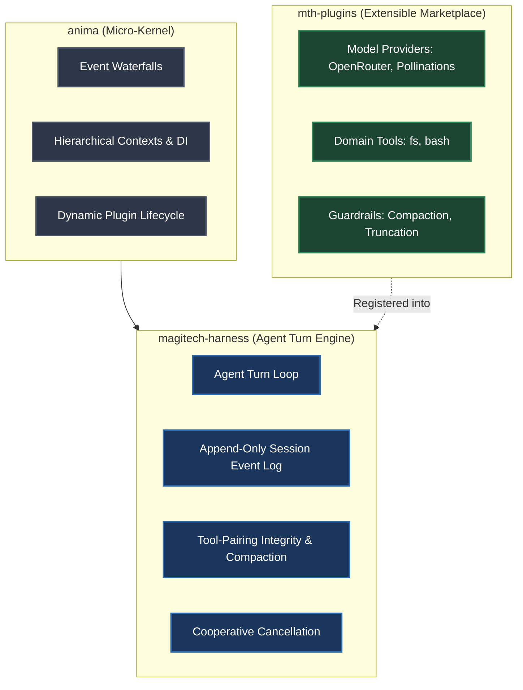

# Magitech AI

Magitech AI builds high-assurance, event-driven agent infrastructure and runtime substrates for autonomous systems.

## Architecture & Ecosystem

### Repositories

- **[`anima`](https://github.com/magitech-ai/anima)**: Foundational asynchronous micro-kernel and event pipeline engine providing waterfall interceptors, context propagation, and effect disposers.
- **[`magitech-harness`](https://github.com/magitech-ai/magitech-harness)**: Composable host runtime substrate and agent turn engine. Contains zero built-in domain tools and zero built-in model providers.
- **[`mth-plugins`](https://github.com/magitech-ai/mth-plugins)**: Official portable plugins and marketplace catalog providing pluggable model providers, domain tools, and compaction guardrails.

---

## Core Invariants

1. **Capability Seam Symmetry**: Every extensible feature consists of a **Service Definition** (protocol), **Service Provider** (plugin implementation), and **Consumer** (turn loop or REPL).
2. **Session Event-Sourcing**: Model-visible data is strictly isomorphic to logged events. Raw session logs are immutable and append-only. Compaction folds historical context while preserving the full event trace.
3. **Tool-Pairing Integrity**: Turn cuts and compaction boundaries never sever an assistant tool call from its matching tool result.
4. **Registrations are Effects**: Every contribution returns an explicit disposer closure; teardown cleanly unwinds without side effects.
5. **Fail-Loud Configuration**: Misconfiguration fails loud at initialization rather than silently falling back or skipping referents.
6. **Strict Quality Gates**: Every package enforces strict `mypy` static typing (`disallow_untyped_defs = true`), formatting with `ruff`, and a mandatory 100% statement and branch coverage floor (`pytest --cov-fail-under=100`).

---

## Issue Tracking & Triage

All repositories in `@magitech-ai` use GitHub Issues and the `gh` CLI with a canonical five-role triage vocabulary:

| Label | Meaning |
| :--- | :--- |
| `needs-triage` | Maintainer needs to evaluate this issue |
| `needs-info` | Waiting on reporter for more information |
| `ready-for-agent` | Fully specified, ready for autonomous agent execution |
| `ready-for-human` | Requires human implementation or review |
| `wontfix` | Out of scope or will not be actioned |